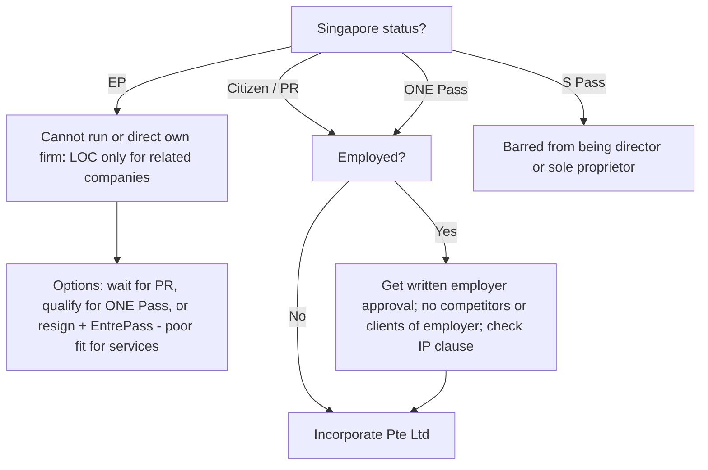

# Remote AI consulting practice in Singapore and Taiwan: blueprint

Decision record: 13 October 2026. Money is in SGD unless marked NT$ or US$. This is research-backed planning, not legal or tax advice. Before you register anything, get the items in §10 signed off by a Singapore CSP/accountant and a Taiwan CPA.

## 0. Known versus assumed

- **Inferred from the repository:** You are Taiwanese and live in Singapore, where you own a condo. You build agentic AI demos for financial-crime review and wealth intelligence, have an ML research background (MIT CSAIL exchange), and do quant work. You write bilingual technical content (`ai-research-insights/`, `ter-agentic-demos/`, `hub/`).
- **Confirmed (13 Oct 2026):** you are a **Singapore PR**. You can register a sole proprietorship or Pte Ltd yourself on Bizfile with Singpass, act as the locally resident director, and no MOM approval is needed. As a sole proprietor you would owe MediSave on net trade income above S$6k; through a Pte Ltd, salary you pay yourself attracts normal CPF. Target market refocused on **SME AI transformation**; see `sme-ai-market-research.md`.
- **Still unknown:** whether you are currently employed (and by a bank?); what your employment contract says about moonlighting, IP assignment and non-solicitation; your weekly hours; and how many days per year you spend in Taiwan.
- **Not verified:** demand from any named buyer, conversion rates, willingness to pay. Every revenue figure below is a pricing anchor or a decision threshold, not a forecast.

## 1. Gate 0: are you allowed to run this? (PR: yes; only the employer branch remains)

- EP holders need a MOM Letter of Consent to be a director elsewhere, and MOM generally grants it only for related companies. In practice an EP holder cannot run his own consultancy ([MOM EP directorship FAQ](https://www.mom.gov.sg/faq/employment-pass/can-ep-holders-be-registered-as-directors-in-another-company), [secondary directorship](https://www.mom.gov.sg/passes-and-permits/employment-pass/taking-up-secondary-directorship)).
- S Pass holders cannot be a director or sole proprietor ([MOM](https://www.mom.gov.sg/faq/s-pass/can-i-start-my-own-business-if-i-am-on-s-pass)).
- ONE Pass allows you to start, run and work for several companies at the same time ([MOM ONE Pass](https://www.mom.gov.sg/passes-and-permits/overseas-networks-expertise-pass)).
- EntrePass is aimed at venture-backed or innovative tech businesses and rules out concurrent employment ([MOM](https://www.mom.gov.sg/passes-and-permits/entrepass/eligibility)).
- **If you work at a bank:** MAS-regulated employers normally require pre-approval for outside business interests. Get approval in writing. Also confirm that the `ter-agentic-demos` and wealth-agent work contain no employer IP or data before you use them as your portfolio.

## 2. Structure decision

**Default: one Singapore Pte Ltd bills both markets. Open a Taiwan entity only when a buyer or grant requires a Taiwan 統編.**

| Option | Year-1 fixed cost | Liability | When to use |
|---|---|---|---|
| SG sole proprietorship | ≈ S$0.5–1.5k (ACRA S$115) | Unlimited | Short paid trial, citizens/PRs only, no bank clients |
| **SG Pte Ltd** (you as resident director) | ≈ S$2–5k (ACRA S$315; AR S$60/yr; company secretary, bookkeeping, Form C-S) | Limited | **Default**: needed for financial-institution vendor onboarding and limited liability |
| SG Pte Ltd with nominee director | ≈ S$4–8k + deposit | Limited | Only if you are a foreigner living abroad (not your case if you are PR/citizen) |
| TW 行號 | ≈ NT$40–70k | Unlimited | Rarely; small domestic training gigs |
| TW 有限公司 | ≈ NT$75–125k | Limited | When TW banks, government tenders, SBIR, or MODA/MOEA subsidies require a TW vendor |
| Bill TW as an individual (9A/50) | ≈ NT$0 | Unlimited | One-off talks only. Clients often withhold 20% and want a 統編 |

Sources: [ACRA structures](https://www.acra.gov.sg/register/business/choosing-business-structure/), [ACRA fees](https://www.acra.gov.sg/manage/sole-proprietorship-partnerships/service-transaction-fees/), [商業登記法](https://law.moj.gov.tw/LawClass/LawAll.aspx?pcode=J0080004). Service-provider prices are market estimates.

LLP is excluded because it needs at least two partners ([ACRA](https://www.acra.gov.sg/register/business/choosing-business-structure/)).

## 3. Tax map

### Singapore company

- Corporate tax is 17%. Under the Start-up Tax Exemption, the first three YAs exempt 75% of the first S$100k and 50% of the next S$100k. After that, the partial exemption applies ([IRAS](https://www.iras.gov.sg/taxes/corporate-income-tax/basics-of-corporate-income-tax/corporate-income-tax-rate-rebates-and-tax-exemption-schemes)).
  - Worked example, S$100k chargeable profit in a new company: S$25k is taxable, so tax is **S$4,250 (4.25%)** before any rebate.
  - YA2026 has a 50% rebate capped at S$40k. A company incorporated now has YA2027 as its first YA, and no YA2027 rebate has been announced yet.
  - The S$2k cash grant requires a local non-shareholder employee, so you won't get it.
- Dividends are one-tier: tax-free to you ([IRAS](https://www.iras.gov.sg/taxes/corporate-income-tax/dividends)).
  - Pay yourself salary up to roughly the 11.5–15% personal bracket and take the rest as dividends ([personal rates](https://www.iras.gov.sg/taxes/individual-income-tax/basics-of-individual-income-tax/tax-residency-and-tax-rates/individual-income-tax-rates)).
  - Salary paid to a citizen/PR director triggers CPF.
- GST registration is compulsory only above S$1M turnover; the rate is 9%.
  - Stay unregistered. Work for Taiwan clients would be zero-rated anyway as an international service under s21(3) ([IRAS](https://www.iras.gov.sg/taxes/goods-services-tax-%28gst%29/charging-gst-%28output-tax%29/when-to-charge-0-gst-%28zero-rate%29/providing-international-services)).
  - Do not label your invoices "tax invoice".
- **Sales hook:** Singapore clients get a **400% EIS deduction on the first S$50k of qualifying AI spend per YA (YA2027–2028)**, and this explicitly includes AI consultancy and strategy. Spend that is grant-funded is excluded ([IRAS EIS e-Tax Guide](https://www.iras.gov.sg/docs/default-source/e-tax/etaxguide_cit_enterprise-innovation-scheme.pdf?sfvrsn=3a36afd3_12)). The client's tax adviser confirms eligibility; you do not promise it.

### Taiwan clients billed from Singapore

- **Where the work is done decides the tax.** Fees for services performed entirely outside Taiwan are not Taiwan-source income, so in principle there is no 20% withholding ([中華民國來源所得認定原則](https://law-out.mof.gov.tw/LawContent.aspx?id=FL050237)).
  - The risk: work becomes Taiwan-source if it is done in Taiwan or "needs the participation of people in Taiwan to be completed". Remote work with client staff in Taiwan is exposed to this.
  - Mitigation, in this order:
    1. The SOW states that all work is performed in Singapore.
    2. Invoices state the place of performance.
    3. Pricing includes a gross-up or withholding-allocation clause.
    4. Get an IRAS certificate of residence so the client can claim treaty relief.
- **New Taiwan–Singapore tax treaty:** signed 2025-12-31, in force 2026-02-13, and **applies from 2027-01-01**. It replaces the 1981 treaty.
  - It adds a **service PE: more than 183 days of services in Taiwan in any 12 months**.
  - It caps withholding on dividends, interest and royalties at 10%.
  - Sources: [北區國稅局](https://www.ntbna.gov.tw/singlehtml/374fe8c4b18e48c691a6806ac02b9984?cntId=411d7c86c20d4ebd9e161d7907746114), [中區國稅局](https://www.ntbca.gov.tw/singlehtml/3c844e426e9c4b5ebcaaa18694d7e230?cntId=9d274ec48b7d4a43b96e9d5d8eece105), [IRAS treaty text](https://www.iras.gov.sg/media/docs/default-source/dtas/singapore-taiwan-dta-(ratified)(13-feb-2026).pdf?sfvrsn=f7651db_4).
  - Keep on-site days in Taiwan well below 183.
- **Business tax:** the Taiwan B2B buyer self-assesses 5% under 營業稅法 §36, and a taxable buyer usually recovers it ([law](https://law.moj.gov.tw/LawClass/LawAll.aspx?pcode=G0340080)).
  - You cannot issue 統一發票. The client books your commercial invoice together with the contract and the remittance slip.

### You personally in Taiwan

- Taiwan tax residency: with a 戶籍, you are resident at **31 days or more** in Taiwan if your life and economic centre is in Taiwan; without one, at 183 days or more ([etax FAQ](https://www.etax.nat.gov.tw/etwmain/alien-tax-service/alien-tax-faq/JKG6lQ7)). A Singapore job, home and family point to Singapore. Count your days every year.
- The individual CFC rule and minimum tax (AMT) on overseas income apply only to Taiwan residents.
  - The CFC rule targets low-tax jurisdictions (≤14%). Singapore's 17% headline rate is normally outside it, but re-check if you ever become a Taiwan resident ([所得基本稅額條例 CFC 辦法](https://law-out.mof.gov.tw/LawContent.aspx?id=GL010345)).
- NHI: the supplementary premium is 2.11% on 9A payments of NT$20k or more. You can suspend NHI (停保) if you will be abroad for more than 6 months ([NHI](https://www.nhi.gov.tw/ch/cp-4516-74b0f-2613-1.html)).

## 4. Positioning and offers

**Positioning:** a vendor-neutral builder of *guarded, evaluated* AI agents for regulated finance, working in English and 繁中 across MAS and FSC requirements.
- The Big 4 sell frameworks; [PwC SG shipped a MAS playbook in 2 days](https://www.pwc.com/sg/en/services/risk/straightaways/mas-ai-risk-management-guidelines.html).
- Product vendors (Tookitaki, Silent Eight) sell their own tool.
- Few independents build the agent, the evaluation harness and the runtime controls, and map all three to the regulation.

**Why now (dated triggers):**
- **MAS Guidelines on AI Risk Management**, issued 7 Oct 2026, take effect **7 Oct 2027**. Lifecycle controls are phased in by Oct 2028. FIs stay accountable for third-party AI, and MAS will consult on agentic AI in 2027 ([MAS release](https://www.mas.gov.sg/news/media-releases/2026/mas-sets-out-supervisory-expectations-on-responsible-ai-adoption-by-financial-institutions), [guidelines page](https://www.mas.gov.sg/regulation/guidelines/guidelines-on-artificial-intelligence-risk-management-for-financial-institutions), [regtech.com](https://www.regtech.com/news/mas-finalises-ai-risk-management-guidelines)).
- **MAS SAFR** (runtime safeguards for agentic finance, Jul 2026) names wealth/advisory compliance-review agents among its use cases. The **MindForge AI risk toolkit** was published Mar 2026 ([MAS](https://www.mas.gov.sg/news/media-releases/2026/mas-partners-industry-to-develop-ai-risk-management-toolkit-for-the-financial-sector)).
- **Taiwan FSC 金融業運用代理AI安全諮詢文件**, issued 13 Oct 2026, has a 30-day comment window. It tiers risk on 3 axes and treats agents as non-human identities ([FSC](https://www.fsc.gov.tw/ch/home.jsp?aplistdn=ou=news,ou=multisite,ou=chinese,ou=ap_root,o=fsc,c=tw&dataserno=202610130003&dtable=News&id=96&mcustomize=news_view.jsp&parentpath=0,2)).
- Taiwan's 人工智慧基本法 has been in force since 14 Jan 2026 ([總統府公報](https://www.president.gov.tw/Page/294/50131)).
- **Demand data:**
  - Taiwan banks: 87% use AI, and financial-crime prevention is a top use ([FSC survey 2025](https://www.fsc.gov.tw/ch/home.jsp?dataserno=202505200001&dtable=News&id=96&mcustomize=news_view.jsp&parentpath=0%2C2)).
  - Taiwan finance AI adoption is 41.8%, with about 90% of firms relying on external vendors ([MIC via TechNice](https://www.technice.com.tw/issues/ai/203170/)).
  - Singapore SME AI adoption is 23.4% and non-SME adoption 70.4% ([IMDA SGDE 2026](https://www.imda.gov.sg/resources/press-releases-factsheets-and-speeches/singapore-digital-economy-2026)).

### Offer ladder

| # | Offer | Buyer | Deliverable | Price anchor | Cycle |
|---|---|---|---|---|---|
| 0 | **Executive workshop**: agentic AI + governance, half or full day | SG fintech, wealth managers; TW mid-size FIs and corporates | Live demo, risk-tiering exercise, 10-page memo | SG S$5–8k; TW NT$80–150k (can be funded by 勞動部 大人提/小人提) | 2–6 wks |
| A | **MAS AIRM readiness sprint** (Sections 3–4) | Heads of Risk, Compliance or CTO at mid-tier SG FIs: payment institutions, CMS licensees, insurers, digital banks, wealth managers | AI inventory incl. third-party AI; materiality tiering; policy, RACI, board pack mapped to MindForge/SAFR; vendor-AI checklist; roadmap to 2028 | **S$25–45k fixed, 4–6 wks**; then S$6–12k/month retainer | 2–4 mo |
| B | **Agentic fin-crime alert-review copilot PoC** | AML/fraud units at TW banks; SG digital banks and payment institutions | 8–10 wk PoC: L1 alert triage and case-narrative agent with human in the loop; evaluation harness against analyst baseline; FSC 3-axis tiering or SAFR checkpoints | **TW NT$1.2–2.5M; SG S$60–120k** | 4–9 mo (faster via a systems integrator as prime contractor) |
| C | **Fractional Head of AI** for FIs | SG fintechs, EAMs; TW mid-size firms | 2–4 days/month: strategy, vendor and model risk, build oversight, hiring | **SG S$8–15k/mo; TW NT$80–200k/mo**, 6-month minimum | 1–3 mo after workshop |

Pricing benchmarks:
- Singapore independent advisory runs S$1,500–3,000/day ([41 Labs](https://41labs.ai/blog/ai-consulting-cost-singapore)).
- Firm list prices are a ceiling ([Pertama Partners](https://www.pertamapartners.com/insights/ai-consulting-pricing-guide)):
  - senior S$550–800/hr;
  - readiness assessment S$15–200k depending on client size;
  - fractional AI lead S$15–35k/month at 2 days/week.
- Taiwan AI-adoption projects run NT$0.5–3M+; retainers NT$80–200k/month ([mo.com.tw](https://mo.com.tw/consulting-price/)).
- Salary floor: a senior Singapore MLE earns about S$220k, which is about S$1,000/day in salary alone. **Do not quote below S$1,500/day.**
- Do not let Taiwan's government expert rate (NT$2,000/hr) or NT$8k LINE-bot shops set your price. Lead in Taiwan with FI and enterprise work.

**Exclude** trading signals, model portfolios and product recommendations to investors. These can be regulated advisory under the MAS Financial Advisers Act ([MAS FA licensing](https://www.mas.gov.sg/regulation/capital-markets/apply-for-licensing-or-registration-of-capital-market-entities/financial-advisers)). Frame quant and wealth work as tooling for licensed FIs.

## 5. Channels

### Singapore

- **Grants changed on 29 Sep 2026:** PSG, EDG and MRA closed and were replaced by **EDGE** ([EnterpriseSG EDGE](https://www.enterprisesg.gov.sg/financial-support/edge-grant), [FAQ](https://www.enterprisesg.gov.sg/resources/all-faqs/edge-grant)).
  - Coverage: up to 50% for SMEs, capped at S$100k/company/year, with a S$30k digital sub-cap.
  - Rules for you as vendor: no work or payment before the client applies; the vendor cannot apply on the client's behalf; reimbursement comes only after completion.
  - Consultancy activities reference SS 680 certification.
  - Decide later whether SS 680 is worth getting. For now, sell unsubsidised and use the EIS 400% deduction as the hook.
- Grants that won't pay you directly:
  - ECI (70% up to S$105k) pays only consultant partners nominated by a cloud provider ([factsheet](https://isomer-user-content.by.gov.sg/500/8f9ed8c1-0c42-40ad-a3f0-8dafa032f5ba/ECI_Factsheet_10_Feb.pdf)). You can enter by subcontracting to one, such as Temus or Thinking Machines.
  - AISG 100E uses its own engineers, so it competes with you.
- Grant your buyer may hold: MAS **AI Pathfinder** for FIs covers 50% up to S$200k for market-tested solutions ([MAS grants](https://www.mas.gov.sg/development/fintech/grants-for-innovation)). Fit is unverified.
- **Singapore FinTech Festival, 18–20 Nov 2026**, is the densest week for FI buyers ([SFF](https://www.fintechfestival.sg/)).
- Communities:
  - BuildFin.ai / SAFR work group;
  - AI Verify Foundation and the AI Tester Accreditation Programme (a later moat; heavy for a solo);
  - Lorong AI.
- GeBIZ: ITQ S$6–90k. Supplier registration needs net tangible assets of at least S$5k ([guide](https://www.gebiz.gov.sg/docs/Supplier_Guide_Detailed.pdf)).
- LinkedIn has 5.5M addressable users in Singapore.

### Taiwan

- **Comment on the FSC agentic-AI consultation before about 12 Nov 2026** via 眾開講. This is free credibility with FI CIOs and CISOs.
- Taiwan AI subsidies (MOEA 服務業 AI, MODA AI 創新服務 up to NT$5M, SBIR) pay **Taiwan-registered** vendors or listed solutions only ([MOEA](https://www.moea.gov.tw/MNS/populace/news/News.aspx?kind=1&menu_id=40&news_id=121967)). This is the trigger for opening a 有限公司.
- **勞動部 大人提/小人提** subsidise in-house corporate training (企業內訓), including external lecturer fees ([WDA](https://onjobtraining.wda.gov.tw/)). This is the most direct paid route into Taiwan companies, through workshops.
- The 產業競爭力輔導團 AI diagnosis runs through institutes. You can join only as a subcontracted expert.
- Freelance platforms (104外包網, Tasker, PRO360) skew low-value. Skip them.
- Channel reach: Facebook 23.8M users, LinkedIn 4.7M; LINE is the business messaging app ([NapoleonCat](https://stats.napoleoncat.com/social-media-users-in-taiwan)). Publish 繁中 long-form content on Facebook/Medium and use LINE for follow-up.

### Your existing asset

The `hub/` site already has a "Start a conversation" brief builder and finance-agent demos. Turn it into the lead funnel:
- one services page per offer (A, B, C, workshop);
- a 繁中 version;
- one case-style write-up per demo, built on synthetic data only.

## 6. 90-day plan (13 Oct 2026 → 15 Jan 2027)

| Week | Action | Exit criterion |
|---|---|---|
| 1 | Resolve Gate 0: residency status, written employer approval, IP clause review | Written OK, or stop and pick a path in §1 |
| 1–2 | Publish two bilingual pieces: "MAS AIRM: what a mid-tier FI must have by 7 Oct 2027" and "FSC 代理AI 三軸風險分級 實作解讀". Submit an FSC comment | Published; comment filed by ~12 Nov |
| 2–3 | Incorporate the Pte Ltd (Bizfile, S$315). Open an Airwallex/Wise account and one local bank account. Set up Xero. Draft the MSA, SOW and DPA templates (§7) | UEN, bank account, templates ready |
| 3–5 | Get PI/tech E&O cover (S$1–5M) and cyber cover; check the policy wording has no AI exclusion. Write the security and data-handling pack | Policy bound; pack written |
| 4–6 | Build a target list: 40 SG mid-tier FIs and 20 TW banks and securities firms. Send 10 warm LinkedIn/LINE messages per week | 15 discovery calls booked |
| 6 (18–20 Nov) | SFF: hold 10 pre-booked meetings and show demo B live | 5 qualified opportunities |
| 7–10 | Run 2 paid workshops (offer 0) and convert them into sprint (A) or PoC (B) proposals | ≥1 signed SOW ≥ S$25k |
| 10–13 | Deliver the first engagement. Collect a referenceable outcome and testimonial | Invoice paid; reference permission |

**Decision thresholds at day 90:**
- **Stop or rethink:** fewer than 10 discovery calls, or no paid workshop.
- **Continue:** 1 signed engagement of at least S$25k.
- **Scale toward full-time:** 2 or more engagements, or a retainer, plus a pipeline worth at least 3× your monthly cost.

## 7. Operations

- **Getting paid:**
  - Invoice in **USD or SGD only, never TWD**.
  - Airwallex SG's Explore plan is free and holds 20+ currencies ([pricing](https://www.airwallex.com/en-sg/pricing)). Wise Business costs S$99 to set up and charges US$6.11 per incoming USD SWIFT payment ([pricing](https://wise.com/sg/pricing/business)). Neither offers TWD receiving details.
  - Taiwan's FX caps (US$10M per individual, US$100M per company per year) are not a constraint. Payments of NT$500k or more only need a declaration form at the client's bank ([CBC](https://www.cbc.gov.tw/tw/cp-302-178539-47467-1.html)).
  - Write "fees borne by remitter (OUR)" into the contract.
  - Stripe works in Singapore but not Taiwan. Card fees (~3.4% + S$0.50) make it suitable only for small self-serve products.
- **Contract terms:**
  - The client owns deliverables on full payment. You keep pre-existing IP (agent scaffolds, evaluation harnesses, prompts) under a non-exclusive licence to the client.
  - Include a no-accuracy-warranty clause for LLM output plus a mandatory human-review clause, especially for AML decisions.
  - Liability cap: 12 months' fees, with indirect and consequential loss excluded.
  - Payment: net 14–30 days; 50% upfront on fixed-fee work; a gross-up or withholding clause for Taiwan clients.
  - **Singapore law, SIAC arbitration seated in Singapore.** Taiwan is not a New York Convention party, but its courts recognise foreign awards under 仲裁法 §47–49 ([law](https://law.moj.gov.tw/LawClass/LawAll.aspx?pcode=I0020001)).
  - English prevails; add 繁中 executive summaries.
- **Data:**
  - Under the Singapore PDPA you are a data intermediary: you owe protection, retention and breach-notification duties, and overseas transfers need s26 transfer clauses ([PDPC MCCs](https://www.pdpc.gov.sg/help-and-resources/2021/01/asean-model-contractual-clauses)).
  - Taiwan's 個資法 was amended 11 Nov 2025 and creates a new PDPC; many articles have no start date yet ([law](https://law.moj.gov.tw/Eng/LawClass/LawAll.aspx?pcode=I0050021)).
  - Bank customer data falls under Banking Act s47 secrecy. **Work in the client's tenant.** Never put client data into personal LLM accounts. Use enterprise or no-training tiers or Singapore-region cloud, and synthetic data for demos.
- **Vendor due diligence:** MAS outsourcing and TRM guidelines, and Taiwan's FSC 作業委託辦法, mean security questionnaires, audit rights and sub-processor lists ([MAS outsourcing](https://www.mas.gov.sg/regulation/guidelines/guidelines-on-outsourcing-banks)). Have the pack ready before the first FI call.
- **Tooling:**
  - Xero, connected to Airwallex;
  - Cal.com for scheduling;
  - DocuSign or Singpass Sign for e-signature (valid under the Singapore ETA and Taiwan's 電子簽章法);
  - HubSpot free or Notion as CRM;
  - a password manager, MFA and full-disk encryption;
  - separate workspaces per client.

## 8. Year-1 budget (Pte Ltd path)

| Item | S$ |
|---|---|
| ACRA incorporation + annual return | 375 |
| Company secretary | 300–800 |
| Bookkeeping, Form C-S, XBRL | 1,200–3,500 |
| PI/E&O (S$1–5M) + cyber | 1,500–5,000 |
| Tools (Xero, e-sign, scheduling, LLM enterprise seats) | 1,500–3,000 |
| SFF pass, events, travel to Taipei (keep days low) | 2,000–6,000 |
| **Total** | **≈ S$7–19k** |

Break-even is one sprint (offer A) or two workshops. Insurance and service-provider quotes are market estimates; get real quotes.

## 9. Risk register

| Risk | Effect | Control |
|---|---|---|
| Work-pass or employer conflict | Business is illegal or you lose your job | Gate 0 before any outreach |
| Employer IP inside the demos | Ownership claim | Rebuild demos on public or synthetic data; get a written IP carve-out |
| Taiwan 20% withholding on gross fees | Margin loss | Offshore-performance clause, gross-up clause, certificate of residence, new treaty from 2027 |
| Taiwan service PE (>183 days) | Taiwan corporate tax | Day log; mostly remote delivery |
| FAA boundary | Unlicensed advisory | No investment recommendations or signals |
| AI-error liability, e.g. a missed SAR | Claim | Human-in-the-loop clause, liability cap, PI without AI exclusion |
| FI sales cycle of 4–9 months | Cash gap | Workshops and fractional retainers first; 50% upfront |
| Taiwan price anchoring | Low rates | Lead with FIs; price PoCs at NT$1M+ |
| Big 4 / systems-integrator competition | Lost deals | Vendor-neutral and hands-on; subcontract under an SI when they are prime |

## 10. Verify with professionals before you act

1. Your exact residency path and whether you need an LOC (MOM; CSP).
2. Your employment contract: outside-work approval, IP assignment, non-solicitation (employment lawyer).
3. Whether your Taiwan clients will accept the offshore-performance position or withhold anyway (Taiwan CPA; 適用所得稅協定查核準則 filing from 2027).
4. EDGE activity codes covering AI consultancy, and whether SS 680 is required for the ones you'd use (EnterpriseSG).
5. EIS AI deduction eligibility wording you can put in proposals (client's tax adviser).
6. 2026 self-employed MediSave rates, if you trial as a sole proprietor ([CPF calculator](https://www.cpf.gov.sg/member/tools-and-services/calculators/self-employed-medisave-contribution-calculator)).
7. PI/E&O quotes with explicit AI/algorithm cover and Taiwan jurisdiction.
